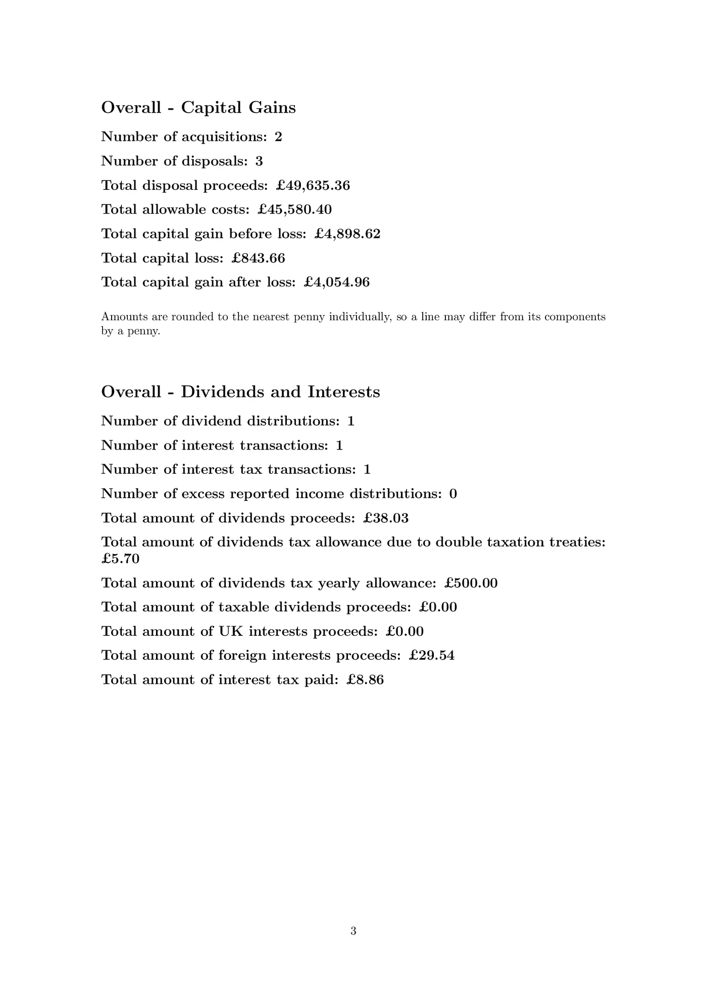

# UK Capital Gains Calculator

Use cgt-calc to calculate **UK capital gains** from your investment transaction history and generate
a detailed report from a supported broker export.

Supported sources include **Charles Schwab**, **Freetrade**, **Hargreaves Lansdown**, **Interactive
Brokers**, **Morgan Stanley**, **Revolut**, **Sharesight**, **Trading 212**, **Vanguard**, or a
custom **RAW** format. Check your broker's guide before starting, especially for employer shares,
because not every award export or transaction type is supported.

## Where to start

- [Installation](installation.md) — install cgt-calc and check that it runs
- [Brokers](brokers/index.md) — find the export instructions for your broker
- [Generate a report](usage.md) — run cgt-calc and check the results
- [Offshore funds (ERI)](offshore-funds.md) — if you hold non-UK funds

## What cgt-calc calculates

For supported transactions, cgt-calc calculates capital gains in **GBP** using the UK **same-day**,
**30-day ("bed and breakfast")** and **Section 104 holding** rules. The terminal summary and
detailed **PDF report** show **Disposal proceeds** (sale amounts or values for other disposals),
**Allowable costs** (costs deducted when calculating gains), gains, losses, dividends and interest.
See [Generate a report](usage.md) for how to create and check them.

For supported tax years, cgt-calc also provides [tax estimates](tax-estimates.md), with an optional
income figure. It covers only the transactions you supply, does not work out your final tax bill and
does not submit a return. Check your [broker's limitations](brokers/index.md) and the
[offshore funds limitations](offshore-funds.md#unsupported-functionality) before relying on the
result.

## Example report

This compact 2025/26 example shows foreign-currency transactions, how sales are matched with shares
acquired at different times, gains and losses, a dividend with overseas tax, and cash interest:

  
  
  

[View full example report (PDF)](assets/example_report.pdf)
